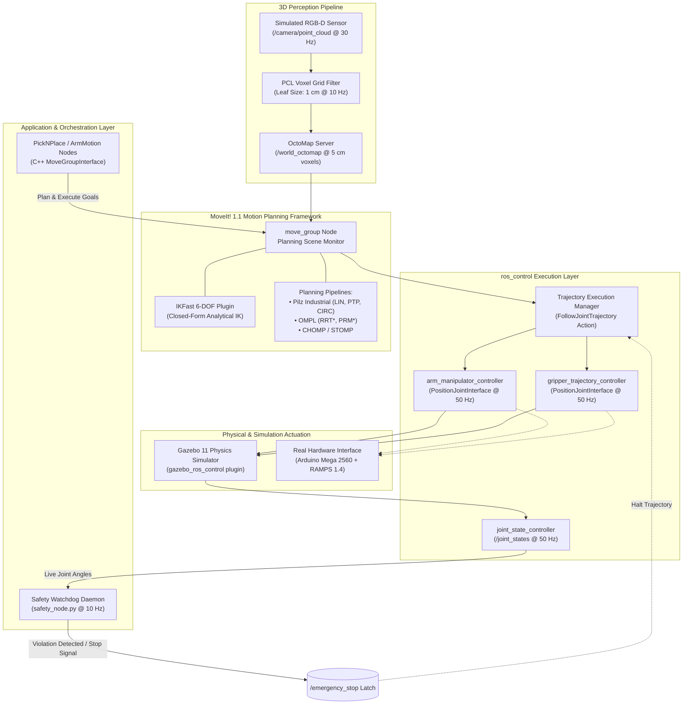

# 6-DOF Robotic Arm — ROS 1 Noetic (Industrial Hardening Baseline)
### Industrial Reference Architecture: MoveIt! Motion Planning, Analytical IKFast, Gazebo Physics, and Active Safety Interlocks

[-brightgreen.svg?logo=ros&logoColor=white)](https://wiki.ros.org/noetic)
[](https://moveit.ros.org/)
[](https://gazebosim.org/)
[](https://github.com/sam-black007/6-dof-robotic-arm-ros1-industrial)
[](https://github.com/sam-black007/6-dof-robotic-arm-ros1-industrial/actions/workflows/ros1-ci.yml)
[](LICENSE)
[](https://github.com/sam-black007/6-dof-robotic-arm-ros1-industrial/pulls)

A production-hardened industrial reference architecture for the **OWR 6-DOF articulated robotic manipulator** equipped with a **Robotiq 2F-140 parallel-jaw adaptive gripper**. 

Designed to transition academic ROS manipulators into predictable, industrially hardened workcells, this repository integrates a high-speed closed-form analytical inverse kinematics solver (**IKFast**), multi-pipeline motion planning (**OMPL, Pilz Industrial Planner, CHOMP, STOMP**), realistic Gazebo physics with high-frequency `ros_control` PID tuning, real-time 3D perception with **OctoMap**, and a dedicated multi-tiered **safety watchdog layer** with latched emergency-stop (`/emergency_stop`) mechanisms.

> [!NOTE]
> **Industrial Baseline Notice:** While ROS 1 Noetic is officially End-of-Life (EOL), this codebase serves as a validated, hardened engineering reference for maintaining existing production workcells, academic research rigs, and as a formal architectural blueprint for migration to ROS 2 (MoveIt 2 / `ros2_control`).

---

<p align="center">
  
</p>

---

## 📑 Table of Contents

- [Key Features](#-key-features)
- [System Architecture](#-system-architecture)
- [Robot Kinematic Specification](#-robot-kinematic-specification)
- [Software Stack & Package Ecosystem](#-software-stack--package-ecosystem)
- [Inverse Kinematics & Motion Planning Pipelines](#-inverse-kinematics--motion-planning-pipelines)
- [Control Architecture & ROS Interface](#-control-architecture--ros-interface)
- [3D Perception & OctoMap Planning Scene](#-3d-perception--octomap-planning-scene)
- [Autonomous Pick-and-Place State Machine](#-autonomous-pick-and-place-state-machine)
- [Multi-Tiered Safety & Emergency Stop](#-multi-tiered-safety--emergency-stop)
- [Physical Hardware Implementation](#-physical-hardware-implementation)
- [Quickstart & Launch Recipes](#-quickstart--launch-recipes)
- [Continuous Integration & Validation](#-continuous-integration--validation)
- [Troubleshooting & Diagnostics](#-troubleshooting--diagnostics)
- [Engineering Documentation](#-engineering-documentation)
- [License & Authorship](#-license--authorship)

---

## ✨ Key Features

- **6-DOF Kinematic Chain with Prismatic Gripper:** High-precision URDF/Xacro modeling featuring collision geometry, realistic joint inertias, and a Robotiq 2F-140 gripper with continuous trajectory action control.
- **Analytical IKFast Solver Plugin:** Sub-millisecond closed-form inverse kinematics computation ($< 5\text{ ms}$ timeout, $0.005\text{ rad}$ search resolution), eliminating local minima and singularities inherent to numerical solvers like KDL.
- **Multi-Pipeline Motion Planning:** Seamless runtime switching between **Pilz Industrial Motion Planner** (deterministic `PTP`, `LIN`, `CIRC` trajectory segments), **OMPL** (RRTConnect, RRT\*, PRM\*), **CHOMP**, and **STOMP**.
- **Real-Time 3D Perception & Volumetric OctoMap:** Simulated RGB-D point cloud processing pipeline with voxel filtering (1 cm leaf) generating live 3D occupancy voxel grids (5 cm resolution) for dynamic collision avoidance.
- **Strict `ros_control` PID Tuning:** Dual `JointTrajectoryController` instances for arm and end-effector operating at 50 Hz with tuned feedforward and feedback gains under `PositionJointInterface`.
- **Active Safety Watchdog & Latched E-Stop:** Independent Python runtime daemon (`safety_node.py`) continuously validating joint positions against URDF physical bounds ($0.05\text{ rad}$ safety envelope) with a bi-directional latched emergency-stop broker.
- **Automated CI/CD:** GitHub Actions workflow compiling the complete workspace and validating dependency resolution on Ubuntu 20.04 LTS against ROS Noetic Desktop Full.

---

## 🏗 System Architecture

The workcell architecture decouples motion generation, execution monitoring, perception, and hardware abstraction into modular, verified layers:



<p align="center">
  
</p>

---

## 🦾 Robot Kinematic Specification

The OWR manipulator is a 6-DOF articulated serial arm with 6 revolute joints (all rotating about their respective local Z-axes) coupled with a Robotiq 2F-140 prismatic parallel gripper. Total reach extends to **~560 mm** from base origin to the end-effector mounting flange.

<p align="center">
  
</p>

### Joint Bounds & Physical Parameters

| Joint | Joint Name | Motion Type | Axis | Angular Limits (deg) | Angular Limits (rad) | Velocity Limit | Effort Limit | Link Mass |
|:---:|:---|:---:|:---:|:---:|:---:|:---:|:---:|:---:|
| **$J_1$** | `BJ` (Base) | Revolute | Z | $-120^\circ \dots +120^\circ$ | $[-2.0944, +2.0944]$ | $5.0\text{ rad/s}$ | $200\text{ N}\cdot\text{m}$ | $2.004\text{ kg}$ |
| **$J_2$** | `SJ` (Shoulder) | Revolute | Z | $-90^\circ \dots +90^\circ$ | $[-1.5708, +1.5708]$ | $5.0\text{ rad/s}$ | $200\text{ N}\cdot\text{m}$ | $1.976\text{ kg}$ |
| **$J_3$** | `EJ` (Elbow) | Revolute | Z | $-225^\circ \dots +60^\circ$ | $[-3.9270, +1.0472]$ | $5.0\text{ rad/s}$ | $200\text{ N}\cdot\text{m}$ | $6.924\text{ kg}$ |
| **$J_4$** | `W1J` (Wrist Roll) | Revolute | Z | $-90^\circ \dots +90^\circ$ | $[-1.5708, +1.5708]$ | $5.0\text{ rad/s}$ | $200\text{ N}\cdot\text{m}$ | $1.641\text{ kg}$ |
| **$J_5$** | `W2J` (Wrist Pitch) | Revolute | Z | $-60^\circ \dots +150^\circ$ | $[-1.0472, +2.6180]$ | $5.0\text{ rad/s}$ | $200\text{ N}\cdot\text{m}$ | $2.384\text{ kg}$ |
| **$J_6$** | `W3J` (Wrist Yaw) | Revolute | Z | $-180^\circ \dots +180^\circ$ | $[-3.1416, +3.1416]$ | $5.0\text{ rad/s}$ | $200\text{ N}\cdot\text{m}$ | $2.168\text{ kg}$ |
| **$G$** | `finger_joint` | Prismatic | Z | $0 \dots 40\text{ mm}$ | $[0.000, 0.040]\text{ m}$ | $0.2\text{ m/s}$ | $50\text{ N}$ | $0.543\text{ kg}$ |

<p align="center">
  
  <br>
  
</p>

### URDF Fixed-Transform Chain & Zero-Pose Verification

The manipulator kinematic structure is defined as a fixed XYZ + RPY homogeneous transformation chain from parent link to child link:

```
world ──[fixed: 0, 0, 0.75m]──> base_link
                                  │
                         BJ ──────┴──> (0.0000, 0.0000, 0.1181m)
                                  │
                         SJ ──────┴──> (0.0000, 0.1157, 0.0775m)
                                  │
                         EJ ──────┴──> (0.0000, 0.0000, 0.35575m)
                                  │
                        W1J ──────┴──> (0.0695, -0.1157, 0.0000m)
                                  │
                        W2J ──────┴──> (0.28625, 0.0000, 0.0000m)
                                  │
                        W3J ──────┴──> (0.0635, 0.0000, 0.1200m)
                                  │
                      EEF_Link ───┴──> (0.0675, 0.0000, 0.0000m) [fixed]
```

At zero configuration ($\theta_i = 0^\circ$ for all joints), the end-effector sits at:
$$\mathbf{P}_{\text{EEF}}^{\text{world}} = \begin{bmatrix} 0 + 0 + 0 + 0.0695 + 0.28625 + 0.0635 + 0.0675 \\ 0 + 0.1157 + 0 - 0.1157 + 0 + 0 + 0 \\ 0.75 + 0.1181 + 0.0775 + 0.35575 + 0 + 0.12 + 0 \end{bmatrix} = \begin{bmatrix} 0.48675\text{ m} \\ 0.00000\text{ m} \\ 1.42135\text{ m} \end{bmatrix}$$

---

## 📦 Software Stack & Package Ecosystem

```
6-dof-robotic-arm-ros1-industrial/
├── owr_description/                             # URDF, Xacro, 3D visual & collision STLs, transmissions
├── owr_gazebo/                                  # Gazebo physics worlds, spawn nodes, PID controllers
├── owr_moveit_config/                           # SRDF, joint limits, kinematics, multi-pipeline launch
├── owr_manipulation/                            # Motion orchestration (C++) and runtime safety daemon (Python)
├── owr_gripper_ikfast_arm_manipulator_plugin/   # OpenRAVE IKFast analytical solver plugin for MoveIt
├── docs/                                        # Technical reference manuals and industrial hardening checklist
└── images/                                      # Architecture, kinematic, and state-machine schematics
```

### Core Package Breakdown

| Package | Role & Contents | Key Files |
|:---|:---|:---|
| [`owr_description`](owr_description/) | Kinematic models, visual & simplified collision meshes, hardware transmission tags, Gazebo plugin bindings. | `urdf/owr.urdf.xacro`, `launch/owr_description.launch` |
| [`owr_gazebo`](owr_gazebo/) | Gazebo simulation physics, environment worlds (`pick_place.world`, `factory.world`), spawn launch files, and joint PID gain parameters. | `config/controllers.yaml`, `config/gazebo_ros_control_params.yaml`, `worlds/pick_place.world` |
| [`owr_moveit_config`](owr_moveit_config/) | MoveIt! 1.1 planning configuration, SRDF collision matrix, planning pipeline XMLs, sensor integration. | `config/owr_gripper.srdf`, `config/kinematics.yaml`, `launch/move_group.launch` |
| [`owr_manipulation`](owr_manipulation/) | C++ trajectory generation, pick-and-place state machine, dynamic planning scene manipulation, and Python safety supervisor. | `src/PickNPlace.cpp`, `src/ArmMotion.cpp`, `safety_node.py` |
| [`owr_gripper_ikfast_...`](owr_gripper_ikfast_arm_manipulator_plugin/) | High-performance C++ analytical solver plugin compiled specifically for the OWR 6-DOF kinematic tree. | `src/owr_gripper_arm_manipulator_ikfast_moveit_plugin.cpp` |

---

## ⚡ Inverse Kinematics & Motion Planning Pipelines

<p align="center">
  
</p>

### Analytical IKFast Plugin Configuration
Numerical inverse kinematics solvers (such as default KDL) are prone to iteration timeouts, drift near singularities, and non-deterministic planning durations. This repository features a compiled **IKFast analytical solver**:

- **Plugin Identifier:** `owr_gripper_arm_manipulator_kinematics/IKFastKinematicsPlugin`
- **Search Resolution:** $0.005\text{ rad}$
- **Solve Timeout:** $0.005\text{ s}$ ($5\text{ ms}$)
- **Characteristics:** Deterministic closed-form algebraic solution; yields instantaneous inverse kinematic solutions without numerical divergence.

### Multi-Pipeline Motion Planning Framework

MoveIt is pre-configured with four hot-swappable motion planning pipelines:

1. **Pilz Industrial Motion Planner (`pilz_industrial_motion_planner`):**
   - Implements deterministic industrial robot motion standards.
   - Generates exact Cartesian Linear paths (`LIN`), Point-to-Point joint motions (`PTP`), and Circular blend curves (`CIRC`).
   - Ideal for predictable palletizing and precision insertion tasks.
2. **OMPL (`ompl_planning_pipeline`):**
   - High-dimensional sampling-based algorithms (`RRTConnect`, `RRT*`, `PRM*`, `BKPIECE`).
   - Best suited for navigating highly cluttered pick-and-place bins and obstacle-dense workcells.
3. **CHOMP (`chomp_planning_pipeline`):**
   - Covariant Hamiltonian Optimization for Motion Planning. Generates smooth, dynamically optimal trajectory profiles.
4. **STOMP (`stomp_planning_pipeline`):**
   - Stochastic Trajectory Optimization for Motion Planning. Handles arbitrary cost functions without gradient calculation.

---

## 🎛 Control Architecture & ROS Interface

<p align="center">
  
  <br>
  
</p>

### Active `ros_control` Controllers

| Controller Name | Controller Type | Managed Joints | Default Action / Feedback Topic |
|:---|:---|:---|:---|
| `arm_manipulator_controller` | `position_controllers/JointTrajectoryController` | `BJ`, `SJ`, `EJ`, `W1J`, `W2J`, `W3J` | `/arm_manipulator_controller/follow_joint_trajectory` |
| `gripper_trajectory_controller` | `position_controllers/JointTrajectoryController` | `finger_joint` | `/gripper_trajectory_controller/follow_joint_trajectory` |
| `joint_state_controller` | `joint_state_controller/JointStateController` | All links | `/joint_states` (Published @ 50 Hz) |

### Real-Time ROS Topic Interfaces

| Topic Name | Message Type | Rate / Bandwidth | Functional Description |
|:---|:---|:---:|:---|
| `/joint_states` | `sensor_msgs/JointState` | $50\text{ Hz}$ | Real-time broadcast of all active joint positions, velocities, and efforts. |
| `/emergency_stop` | `std_msgs/Bool` | Event-driven / $10\text{ Hz}$ | Bidirectional, latched hardware/software emergency stop signal. |
| `/arm_manipulator_controller/state` | `control_msgs/JointTrajectoryControllerState` | $50\text{ Hz}$ | Desired, actual, and error vectors for all 6 arm joints. |
| `/camera/point_cloud` | `sensor_msgs/PointCloud2` | $30\text{ Hz}$ | Raw point cloud stream generated by simulated RGB-D perception head. |
| `/camera/filtered_cloud` | `sensor_msgs/PointCloud2` | $10\text{ Hz}$ | Downsampled point cloud filtered through PCL VoxelGrid (1 cm leaf). |
| `/world_octomap` | `octomap_msgs/Octomap` | $10\text{ Hz}$ | Live 3D occupancy grid consumed by the MoveIt Planning Scene Monitor. |

### Tuned Joint PID Control Profiles

To eliminate oscillation and steady-state error under heavy gravitational loading, joints are tuned using individual PID loops in `owr_gazebo/config/gazebo_ros_control_params.yaml`:

<p align="center">
  
</p>

| Joint | Proportional ($P$) | Integral ($I$) | Derivative ($D$) | $I_{\text{clamp}}$ |
|:---|:---:|:---:|:---:|:---:|
| `BJ` | $1000.0$ | $0.0$ | $100.0$ | $1.0$ |
| `SJ` | $2000.0$ | $0.0$ | $200.0$ | $1.0$ |
| `EJ` | $1500.0$ | $0.0$ | $150.0$ | $1.0$ |
| `W1J` | $500.0$ | $0.0$ | $50.0$ | $1.0$ |
| `W2J` | $500.0$ | $0.0$ | $50.0$ | $1.0$ |
| `W3J` | $100.0$ | $0.0$ | $10.0$ | $1.0$ |

---

## 👁 3D Perception & OctoMap Planning Scene

The workcell dynamically maps its surrounding environment in real time using an eye-to-hand RGB-D sensor streaming into a volumetric OctoMap:

<p align="center">
  
  <br>
  
</p>

1. **Depth Stream Acquisition:** The simulated sensor emits high-density raw 3D point clouds on `/camera/point_cloud` at 30 Hz.
2. **Voxel Grid Downsampling:** A real-time node filter downsamples the raw stream using an axis-aligned bounding voxel grid with a leaf size of **$1\text{ cm}$** ($0.01\text{ m}$), reducing processing overhead by > 75%.
3. **OctoMap Volumetric Integration:** The filtered cloud is projected into an OctoMap occupancy tree at a voxel resolution of **$5\text{ cm}$** ($0.05\text{ m}$).
4. **Dynamic Collision Geometry:** Voxels within the robot's self-filtering envelope are masked; remaining occupied cells are automatically appended to the MoveIt collision world, enabling collision-free trajectory re-routing around dynamic obstacles.

---

## 🔄 Autonomous Pick-and-Place State Machine

The repository includes a production-grade pick-and-place application node (`owr_manipulation/src/PickNPlace.cpp`) designed as an 8-stage deterministic state machine:

<p align="center">
  
</p>

```
  [1. Approach Target]
          │
          ▼
   [2. Descend / Pre-Grasp]
          │
          ▼
   [3. Close Gripper & Grasp]
          │
          ▼
   [4. Attach Object to Scene]
          │
          ▼
   [5. Lift & Post-Grasp Retreat]
          │
          ▼
   [6. Transport to Destination]
          │
          ▼
   [7. Descend & Release Gripper]
          │
          ▼
   [8. Detach Object & Retreat to Home]
```

- **Collision Scene Synchronization:** The node dynamically issues `AttachedCollisionObject` and `CollisionObject` diff messages via `moveit::planning_interface::PlanningSceneInterface`, preventing false-positive self-collision alarms when lifting heavy objects.
- **Fail-Safe Recovery:** If IK fails during Cartesian descent or grasp verification times out, the node executes a deterministic safe-retreat vector back to the neutral home pose.

---

## 🛡 Multi-Tiered Safety & Emergency Stop

<p align="center">
  
</p>

Safety enforcement is decoupled across four isolated rings:

1. **Planning Boundary Ring (MoveIt):**
   - Hardware limits are strictly configured in `joint_limits.yaml`.
   - Max velocity is scaled to $5.0\text{ rad/s}$ ($286.5^\circ/\text{s}$); acceleration is bounded to prevent motor torque saturation.
   - Trajectory goals requesting poses outside bounds are rejected at the planner level.
2. **Execution Monitoring Ring (`ros_control`):**
   - Goal tolerance is constrained to $\pm 0.1\text{ rad}$.
   - If path execution deviation exceeds threshold, the trajectory action immediately aborts.
3. **Active Watchdog Supervisor (`safety_node.py`):**
   - Monitors `/joint_states` at 10 Hz.
   - Calculates proximity to physical hard limits using a safety buffer:
     $$\theta_{\text{lower}} + 0.05\text{ rad} \le \theta_i \le \theta_{\text{upper}} - 0.05\text{ rad}$$
   - If any joint violates this boundary, or if a external stop trigger is detected, the node latches `/emergency_stop` (`True`) and broadcasts cancel requests across all active action servers.
4. **Physical Hardware Ring:**
   - Dedicated physical emergency stop cutoffs must disconnect the main 12V motor DC rail on RAMPS 1.4 independently of software state.

---

## 🔩 Physical Hardware Implementation

While the workcell runs natively within Gazebo 11, the architecture maps 1:1 onto low-cost physical maker robotics hardware:

| Hardware Subsystem | Component Specification | Role / Notes |
|:---|:---|:---|
| **Microcontroller / Interface** | Arduino Mega 2560 (ATmega2560) | Executes `rosserial_arduino` bridge or low-level G-code interpreter. |
| **Power Distribution Shield** | RAMPS 1.4 (RepRap Arduino Mega Pololu Shield) | Direct header breakout for 6x stepper drivers, limit switches, and 12V rails. |
| **Actuators (Joints 1–6)** | 6x NEMA 17 Stepper Motors (`42BYGH47`) | $1.8^\circ$ step angle ($200\text{ steps/rev}$), $0.44\text{ N}\cdot\text{m}$ holding torque. |
| **Motor Drivers** | A4988 or DRV8825 Microstepping Drivers | Configured for 1/16 or 1/32 microstepping with thermal heat sinks. |
| **End-Effector** | Robotiq 2F-140 Parallel Adaptive Gripper | Prismatic finger actuation ($0\dots 40\text{ mm}$ stroke). |
| **Power Supply** | 12 V / 5 A Regulated DC Switching PSU | Dedicated high-current rail feeding motor coils through RAMPS. |

---

## 🚀 Quickstart & Launch Recipes

<p align="center">
  
</p>

### 1. Prerequisites & Environment Setup
- **OS:** Ubuntu 20.04 LTS (Focal Fossa)
- **Middleware:** ROS Noetic Desktop Full (`ros-noetic-desktop-full`)
- **Build Tool:** `catkin_make` or `catkin tools`

```bash
# Update package indices and install core dependencies
sudo apt update
sudo apt install -y python3-rosdep python3-catkin-tools git

# Initialize rosdep if not previously configured
sudo rosdep init
rosdep update
```

### 2. Workspace Setup & Compilation
```bash
# Create and navigate to catkin workspace
mkdir -p ~/catkin_ws/src
cd ~/catkin_ws/src

# Clone the repository
git clone https://github.com/sam-black007/6-dof-robotic-arm-ros1-industrial.git 6dof

# Resolve package dependencies automatically
cd ~/catkin_ws
rosdep install --from-paths src --ignore-src -r -y

# Build the workspace
catkin_make -DCMAKE_BUILD_TYPE=Release
source devel/setup.bash
```

### 3. Launching the Hardened Workcell

For reliable operation, launch subsystems across dedicated terminals:

#### Terminal 1: Gazebo Physics Simulation & Robot Spawn
```bash
source ~/catkin_ws/devel/setup.bash
roslaunch owr_gazebo robot_6dof_gazebo_spawn.launch gui:=true
```

#### Terminal 2: MoveIt! Planning Framework & RViz
```bash
source ~/catkin_ws/devel/setup.bash
roslaunch owr_moveit_config robot_6dof_moveit_sim.launch
```

#### Terminal 3: Active Safety Watchdog Supervisor
```bash
source ~/catkin_ws/devel/setup.bash
rosrun owr_manipulation safety_node.py
```

#### Terminal 4: Automated Motion Demo / Pick-and-Place
```bash
source ~/catkin_ws/devel/setup.bash

# Run basic joint/Cartesian motion smoke test:
rosrun owr_manipulation ArmMotion

# OR run autonomous 8-stage pick-and-place pipeline:
rosrun owr_manipulation PickNPlace
```

### 4. Workcell Verification Commands
```bash
# Verify controller status:
rosservice call /controller_manager/list_controllers

# Verify joint state frequency (should report ~50 Hz):
rostopic hz /joint_states

# Verify emergency stop status:
rostopic echo /emergency_stop -n 1
```

---

## 🔄 Continuous Integration & Validation

<p align="center">
  
</p>

Every push and pull request triggers an automated GitHub Actions workflow (`.github/workflows/ros1-ci.yml`):
- **Container Environment:** Ubuntu 20.04 LTS runner.
- **Dependency Isolation:** Automated installation of `ros-noetic-desktop` and fresh `rosdep` keys.
- **Compilation Gate:** Builds all five workspace packages using `catkin_make` under strict flags to guarantee zero missing headers, unlinked targets, or CMake configuration drift.

---

## 🔍 Troubleshooting & Diagnostics

| Symptom / Error | Probable Cause | Corrective Action |
|:---|:---|:---|
| **Controller Spawner Times Out** | Gazebo physics clock not advancing or plugin failed to load. | Ensure your GPU drivers are active. Try launching with `gui:=false` or set `export LIBGL_ALWAYS_SOFTWARE=1` in virtual environments. |
| **MoveIt: "No kinematics plugin found"** | `kinematics.yaml` pointing to missing plugin shared object. | Recompile the workspace (`catkin_make`) to ensure `owr_gripper_ikfast_arm_manipulator_plugin` is properly registered with `pluginlib`. |
| **Safety Node Trips E-Stop on Boot** | Arm spawned into Gazebo near a hard limit margin. | Check the initial spawn joint positions in `robot_6dof_gazebo_spawn.launch`. Run `rostopic pub /emergency_stop std_msgs/Bool "data: false"` to clear latched state after repositing. |
| **OctoMap Empty in RViz** | Camera point cloud topic mismatch or sensor frame transform missing. | Confirm `/camera/point_cloud` is publishing (`rostopic hz /camera/point_cloud`). Ensure RViz Fixed Frame is set to `world` or `base_link`. |
| **Trajectory Aborted: Goal Tolerance Violated** | Low PID gains leading to motor lag under gravity. | Increase the proportional gain ($P$) on `EJ` or `SJ` in `owr_gazebo/config/gazebo_ros_control_params.yaml`. |

---

## 📚 Engineering Documentation

Detailed engineering reports, math models, and industrial auditing checklists are cataloged in [`docs/`](docs/):

- 📘 **[Technical Reference Manual](docs/TECHNICAL_REFERENCE.md):** Complete mathematical reference covering kinematic chains, DH parameters, forward kinematic proofs, ROS interfaces, controller parameters, and perception filtering pipelines.
- 📋 **[ROS 1 Industrial Checklist](docs/ROS1_INDUSTRIAL_CHECKLIST.md):** Formal compliance checklist tracking code cleanliness, license validation, CI gates, and safety provisions.
- 🗺 **Additional Architecture Diagrams:**
  - [Workspace Structure Layout](images/workspace_structure.png)
  - [Controller Stack Breakdown](images/controller_stack.png)
  - [ROS 1 vs ROS 2 Hardening Tradeoffs](images/ros1_vs_ros2.png)
  - [Collision Geometry Disabled Pairs](images/collision_disabled_for_3_objects.png)

---

## 📄 License & Authorship

Distributed under the open-source **MIT License**. See [`LICENSE`](LICENSE) for full details.

- **Author & Maintainer:** [sam-black007](https://github.com/sam-black007)
- **Repository:** [6-dof-robotic-arm-ros1-industrial](https://github.com/sam-black007/6-dof-robotic-arm-ros1-industrial)

```
Copyright (c) 2026 sam-black007
```

---

<div align="center">
  <sub>Hardened with precision to turn academic robotics into robust industrial workcells.</sub>
</div>
